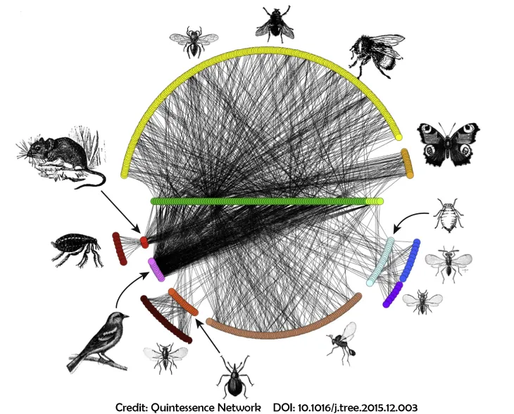

## Species interactions in Ecological Communities


::: column 

- Interactions are the backbone of ecological communities.

- The collective of interactions in a community describe their **organization** and **potential vulnerability to disturbance**.

- Ecological networks (e.g. producer-consumer networks) capture these diversity

- The variation in ecological network structure describes how interactions among species in a community vary across space and/or time
:::

::: column 


::: 

## Limitations to study the biogeography of species interactions

::: column 

#### Data

- Documenting local ecological networks remains difficult and costly.

- Sparse local interaction data


:::

::: column 
#### Logic 
- Fragmented analytic applications 

- Limited software ecosystem 


:::

::: takeaway

**MetaWeave separates local assemblages, interaction models, and network outputs into interchangeable components.**

:::


## Regional metawebs support spatial inference of networks

A **metaweb** describes interactions that may occur in a regional species pool.

- Aggregated network summary across many locally observed networks in a region

- The Metaweb can inform statistical models that predict network assembly


::: takeaway
Existing approaches connect distributions, traits, and environmental conditions to network predictions, but their implementations remain fragmented.

:::


## A common interface for interaction inference

For each local assemblage, MetaWeave applies an inference model through a common interface:

$$\widehat{G}_{\ell}=\mathcal{I}(C_{\ell},M),$$
where $\widehat{G}_{\ell}$ is the inferred network at locality $\ell$, $C_{\ell}$ is its species assemblage, $M$ is the supplied model and $\mathcal{I}$ is the inference procedure.

::: takeaway
Metaweave functions revolve around two ecological inference problems:

- Same communities, different interaction assumptions: *How do interaction assembly shape network structure?*

- Same interaction assumptions, different communities: *How does species turnover reshape potential networks?*
:::


## Available in CRAN 

<br> 

<br> 
``` r 
install.packages('metaweave')

library(metaweave)
```


## Local assemblages begin with species distributions

### `assemble_communities()`

Build local species lists from a named collection of aligned distribution rasters.

``` r
assemblages <- assemble_communities(
  distributions,
  min_species = 1L
)
```

`distributions` a named list for each trophic level with a raster stack on each slot

- One raster layer per species. 
- Presence–absence inputs.

## Interaction models express ecological assumptions

| Function | Supplied information |
|------------------------------------|------------------------------------|
| `probability_matrix_model()` | Named species-pair probabilities or binary regional links |
| `block_model()` | Species memberships and probabilities between blocks |
| `new_inference_model()` | A custom prediction function, optionally using traits or local context |


## Inference retains the local interaction matrices

| Function                             | Scope                             |
|--------------------------------------|-----------------------------------|
| `infer_network(assemblage, model)`   | One local community               |
| `infer_networks(assemblages, model)` | A collection of local communities |

``` r
networks <- infer_networks(assemblages, model)
networks$networks[[1]]$matrix
```
## Convenience functions combine the workflow steps

| Function | What it combines |
|------------------------------------|------------------------------------|
| `reconstruct_networks()` | Assemblage construction and local network inference |
| `run_spatial_inference()` | Assemblage construction, inference, summaries, and mapped metrics |

``` r
result <- run_spatial_inference(
  distributions,
  model,
  min_species = 1L
)
```

